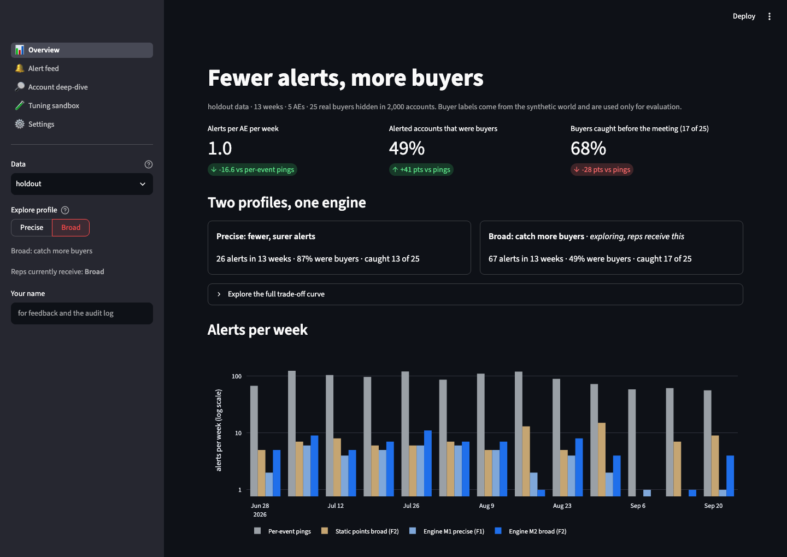
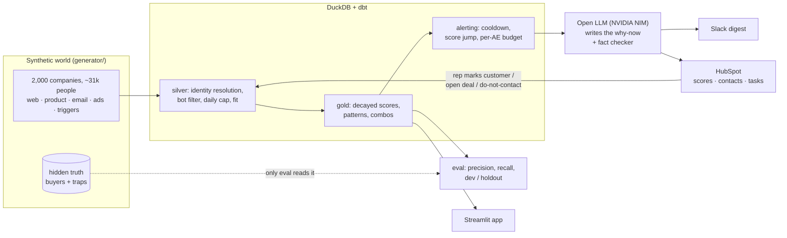
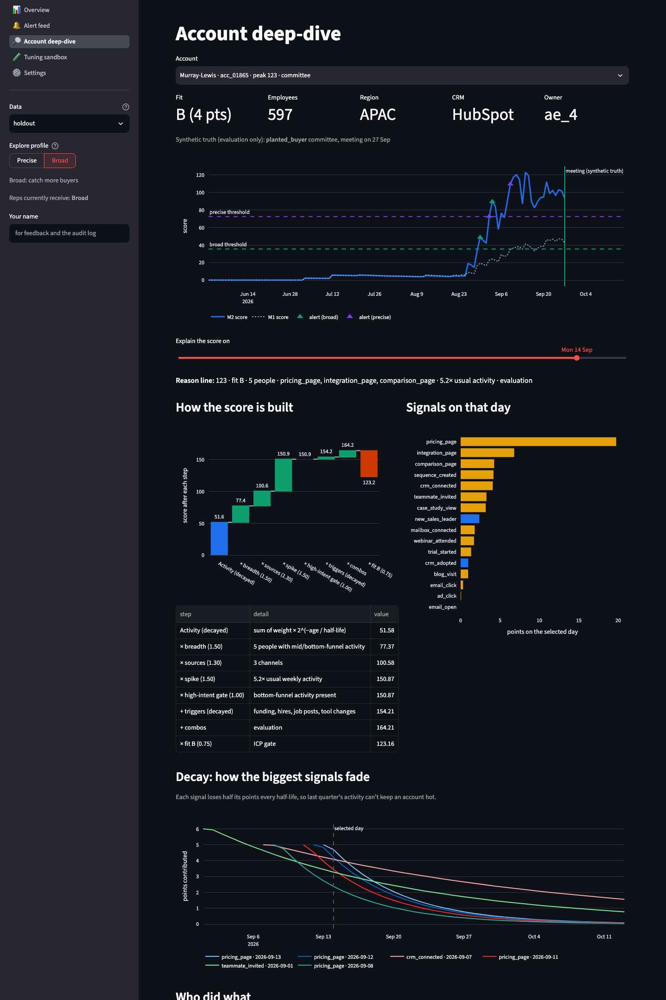
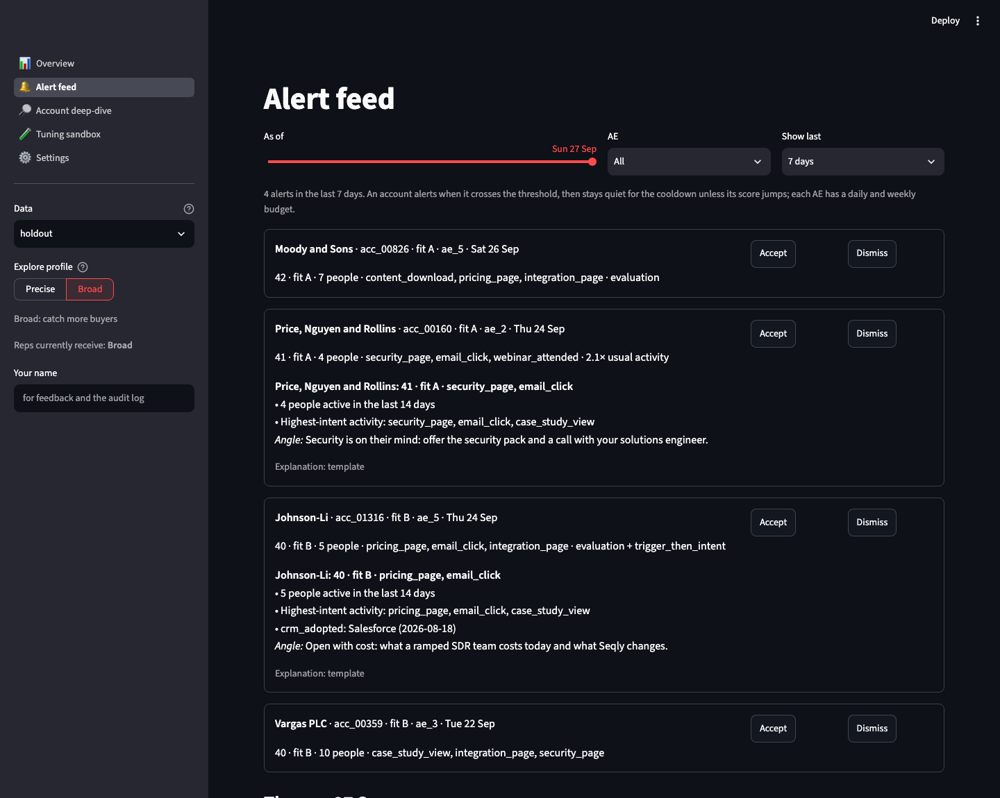

# Signal Engine: fewer alerts, more buyers

[](https://github.com/aloks1490/Multi-Signal-Attribution-and-Signal-Fatigue-Filtration/actions/workflows/ci.yml)

Sales teams drown in alerts: every pricing-page visit, ad click and job change pings a rep, reps stop reading them, and real buyers get missed. This project replaces one-alert-per-event with **account-level intent scoring**: signals decay over time, patterns across people and channels count more than single events, and a rep gets a short daily list of accounts with a plain-English reason, in Slack and in HubSpot.

It is tested the hard way: on a synthetic market of 2,000 companies where 25 real buyers and 64 look-alike traps are planted, and the scoring code never sees which is which.

## Results

On the holdout world (13 weeks, 5 account executives, 25 hidden buyers among 2,000 accounts):

| Method | Alerts in 13 weeks | Alerts per AE per week | Alerted accounts that were buyers | Buyers caught before the meeting |
|---|---:|---:|---:|---:|
| Ping on every pricing / security / demo event | 1,149 | 17.7 | 7.6% | 96% |
| Classic lead scoring (points, no decay) | 92 | 1.4 | 20.7% | 76% |
| Engine M1: decay + fit + exclusions | 43 | 0.7 | 55.6% | 60% |
| **Engine M2: + patterns, broad profile (live)** | **67** | **1.0** | **48.6%** | **68%** |
| Engine M2: precise profile | 26 | 0.4 | 86.7% | 52% |

- **17× fewer alerts than per-event pings**, and about half of the alerted accounts are real buyers (vs 1 in 13).
- The traps mostly stay quiet. Out of 8 planted per type, M2 broad alerts on: bot bursts 0, content bingers 0, trigger-only accounts 0, customers / open deals / bad-fit look-alikes 0, single-person pricing hammerers 4, stalled trials 1. Per-event pings fall for 8 hammerers and 8 stalled trials.
- **Missed:** the 5 "random converters" (buyers who leave no signal, planted so recall cannot be 100%), 2 quiet two-person buyers and 1 product-led buyer.
- **At equal alert volume**, M2 is more precise than M1 at every budget and catches as many or more buyers at three of four budgets (at about 40 alerts: 78% vs 63% precision, 56% vs 60% recall). Classic lead scoring is far behind at every budget. Full tables: [docs/results.md](docs/results.md).

Synthetic data proves the machinery, not the weights. With real data, the same pipeline would tune weights from outcomes.



## How it works



**Score** for an account on day *d*, using only what was known before *d*:

```
score = fit × ( activity × breadth × sources × spike × gate  +  triggers  +  combos )
```

- **activity / triggers:** every event has a weight and a half-life (pricing page 5 points, halves every 5 days; new sales leader 5, halves every 60). Old activity fades, so last quarter cannot keep an account hot.
- **breadth:** one person ×0.7, three people ×1.3, four or more ×1.5. A single enthusiast cannot carry an account.
- **sources:** activity across web, product, email and ads counts more than one channel.
- **spike:** this week vs the account's own 8-week normal (only when 2+ people are active).
- **gate:** no bottom-of-funnel activity (pricing, security, product limits) in 14 days damps the score.
- **combos:** named patterns, e.g. pricing + security pages by two people, or a trial plus a teammate invite.
- **fit:** ICP grade A–D; D is excluded.

All weights, half-lives, multipliers and bonuses are CSV seeds in [`dbt_project/seeds/`](dbt_project/seeds/), so tuning is a config change.

**Alerting:** an account alerts when it crosses the threshold, then stays quiet for 14 days unless its score jumps 1.5×. Each AE gets at most 2 alerts a day and 10 a week; extras wait up to 3 days in a queue. Demo requests skip scoring and go to the top of the digest.

**Two thresholds, one engine:** *precise* (best F1 on dev data: fewer, surer alerts) and *broad* (best F2: catches more buyers). A team-level setting picks which one reaches reps; the app lets anyone explore both.

## The daily loop

A GitHub Actions workflow runs every weekday at 06:00 UTC: rebuild the world, read exclusions back from HubSpot, score, explain, post, sync. Because the data is synthetic, each run replays one day of the quarter.

**Explanations.** An open model on NVIDIA NIM's free tier (`nemotron-3.5-super`) gets a fact sheet per alert and writes the why-now. A checker rejects any output that mentions a person, number or name not in the facts and falls back to a template. On a 40-alert sample, 39 passed; every rejection was a wording false alarm, not an invented fact. One digest entry, exactly as the model wrote it (GitHub run, 28 Jul replay; the people are synthetic):

> **Cox, Avery and Walters** · score 85 · fit A · score jumped<br>
> Cox, Avery and Walters shows strong BOFU intent with 8 pricing page views and a new Head of Sales Development<br>
> • 8 pricing page views in the last 14 days indicate active buying interest<br>
> • A new Head of Sales Development started on 2026-05-13, creating a window to engage a new sales leader<br>
> • 4 comparison page views show the account is evaluating vendors<br>
> *Contact first:* John House (SDR): John House is an SDR who viewed pricing and comparison pages, showing direct buying intent; Jack Carson (Sales Ops Specialist): Jack Carson is a Sales Ops Specialist who clicked an email, indicating engagement with outreach<br>
> *Angle:* Ask John House how Seqly can help the SDR team hit quota under the new Head of Sales Development.

**Slack:** one digest message: demo requests first, then each AE's new alerts with headline, reasons, who to contact and the angle.

**HubSpot:** score, tier, reason and headline on each company record, the active buying group as contacts, and one task per alert. Before scoring, the run reads HubSpot back: if a rep marks a company as a customer, adds an open deal or ticks do-not-contact, it stops alerting. Synthetic domains are pushed as subdomains of the reserved `example.com`, so fake records never match real companies.

| Account deep-dive: score history, the formula step by step, decay | Alert feed with reasons and accept / dismiss |
|---|---|
|  |  |

## Why the evaluation can be trusted

- **A truth wall.** Buyer labels live in their own schema. No dbt model may read it (a test parses dbt's manifest to check), and neither may the Slack or HubSpot code.
- **Traps, not just noise.** 8 look-alike types: single-person pricing hammerers, bot bursts, content bingers, trigger-only accounts, stalled trials, active customers, open deals, bad-fit companies. Background activity is heavy-tailed, and funding rounds and hires happen at non-buyers too, so triggers alone cannot find buyers.
- **Point-in-time scoring.** A score for day *d* uses only events known before *d*, including identity: an anonymous visit linked to a contact later does not count for earlier days. A test deletes every event after a cutoff, rebuilds, and checks that earlier scores do not change.
- **Dev / holdout.** Thresholds are tuned on one synthetic world (seed 42) and reported on another (seed 7) they never saw.
- **Fair comparisons.** Every method is also compared at the same alert volume, chosen from counts alone.

## Design choices and trade-offs

| Choice | Why |
|---|---|
| Daily batch, not streaming | B2B intent builds over days; a daily run loses almost nothing. Only demo requests need speed, and they skip scoring. |
| Deterministic score, LLM only for wording | Scores must be cheap, reproducible and testable on 2,000 accounts a day. The model explains; it never decides who alerts. |
| Free open model + fact checker | Costs nothing, and the checker plus template fallback means a flaky free endpoint can never block or corrupt the digest. |
| Capacity is a ceiling, not a target | Filling 50 alerts a week pushed the threshold to one pricing visit and precision to 4%. The threshold is tuned for quality, under the ceiling. |
| Two profiles instead of one "best" threshold | Precision vs recall is a business choice; the team picks it, and the change is logged. |
| One alerting implementation | The rules live in one Python function used by the dbt model and by calibration, so simulated and real alerts always agree (tested). |
| DuckDB locally | Free, zero setup, handles this volume on a laptop; the dbt models port to Snowflake or Databricks by changing the adapter. |
| HubSpot as current state | Correct for production; the replay applies today's CRM state to past days, which the docs state plainly. |

## Limits

- The data is synthetic: the engine is shown to work on a world built to resemble B2B buying, not on real outcomes.
- Identity resolution is simplified (email plus an IP-to-company map); in production it is the hardest part.
- One person wrote both the generator and the scorer. Mitigations: traps were defined before tuning, a holdout world, and a truth wall; a blind test set planted by someone else would be stronger.
- GitHub runners start empty, so the explanation cache and post log last one run.

## Stack

Python 3.12 (uv) · Faker · DuckDB · dbt-core + dbt-duckdb (SQL models, a Python model, data and unit tests) · Streamlit + Plotly · NVIDIA NIM / OpenRouter (any OpenAI-compatible endpoint) · Slack incoming webhook · HubSpot CRM API · GitHub Actions · pytest

## Run it

Requires [uv](https://docs.astral.sh/uv/).

```bash
make setup    # install
make m1       # build both worlds, calibrate, write docs/results.md (~50 s)
make test     # 100 pytest tests; dbt runs 86 nodes with data and unit tests
make app      # Streamlit app on http://localhost:8501
uv run python -m activation --as-of 2026-07-28 --dry-run       # one day's Slack digest → out/
uv run python -m activation.crm push --as-of 2026-07-28 --dry-run   # what HubSpot would receive
```

Everything runs without keys (template explanations, dry-run Slack and HubSpot). To go live, add repository secrets `SLACK_WEBHOOK_URL`, `LLM_API_KEY`, `HUBSPOT_TOKEN` and variables `LLM_BASE_URL`, `LLM_MODEL`, `LLM_EXTRA_BODY`: see [docs/implementation.md §14–15](docs/implementation.md).

## Repository

```
generator/     the synthetic world (the only code that knows the truth)
dbt_project/   staging → silver → gold models; seeds are the tuning config
engine/        alerting rules: cooldown, score jump, per-AE budget
activation/    explanations, fact checker, Slack digest, HubSpot sync, daily run
eval/          calibration, metrics, results report (reads the truth)
app/           Streamlit app; data and chart layers are UI-free for a later Reflex port
tests/         pytest suite
docs/          implementation spec, results, screenshots
```

Design rationale and decision history: [context.md](context.md). Full spec (schema, scoring, tests, milestones): [docs/implementation.md](docs/implementation.md).

## What's next

Per-signal lift backtest (which signals actually predicted meetings), a separate post-outreach model for replies and "not now", buying-group persona analysis, LLM classification of press releases and job posts, a blind test set, a hosted app, and a Reflex version of the frontend.
