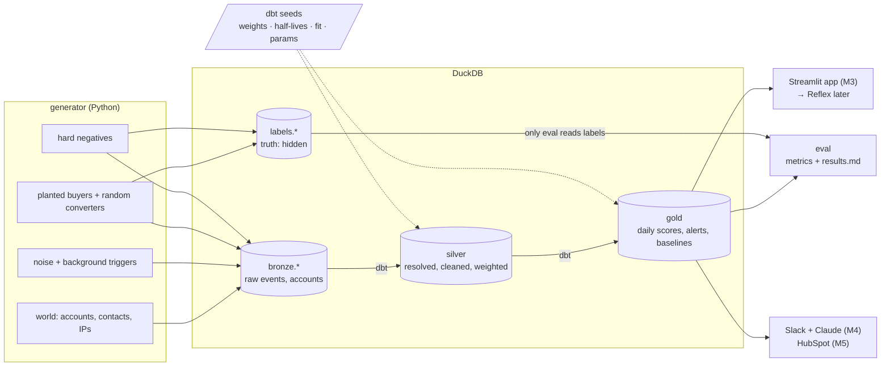
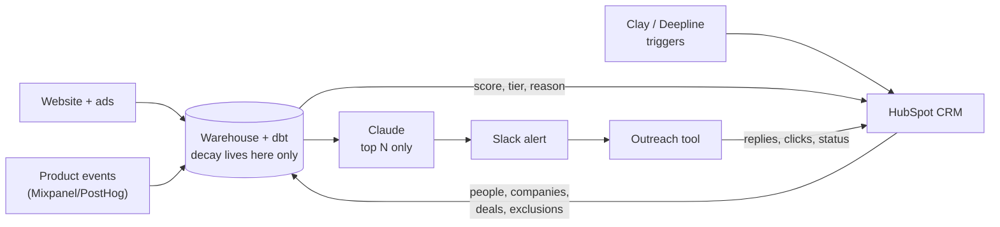
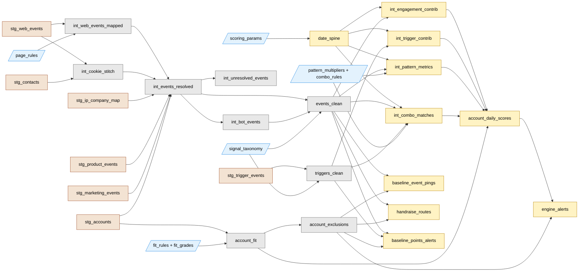
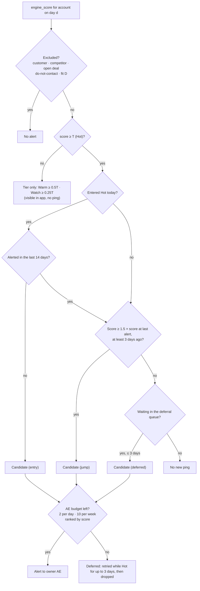
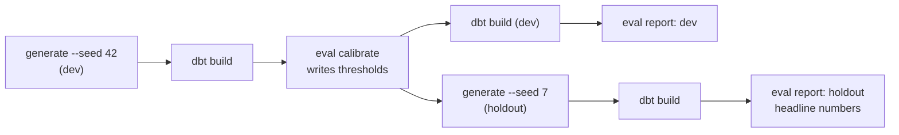

# Signal Engine: Implementation Spec

Status: M1–M5 built · 30 Oct 2026 · owner: Alok Singh

This is the build reference. [context.md](../context.md) explains *why* the design looks like this; this file says *what* gets built, in what shape, and how we know it works.

---

## 1. Goal

Reps get one alert per event and ignore all of them. The engine replaces that with a daily list of accounts that show a buying **pattern**, each with a reason, capped at what the team can work.

The project is judged by one table: **per-event pings vs static points vs the engine**, on alerts per AE per week, precision and recall, measured on synthetic data where the true buyers are known but hidden from the scoring code.

### Fictional company

**Seqly** (fictional) sells a sales-engagement platform: email and call sequences, mailbox integration, CRM sync.

| ICP attribute | Target | Fit points |
|---|---|---|
| Employee count | 50–1,000 | 2 (20–49 or 1,001–5,000: 1) |
| Industry | B2B software, fintech, martech, HR tech, cybersecurity, data & analytics | 1 |
| Region | North America, Europe (incl. UK) | 1 |
| CRM | Salesforce or HubSpot | 1 |
| Sales team | `sales_headcount` ≥ 5 | 1 |

Fit grade: **A** = 5–6 points, **B** = 4, **C** = 3, **D** = 0–2.
A company using a competitor (Outreach, Salesloft, Apollo) is not scored higher on fit; it changes the talk track (displacement), and dropping that tool is a trigger.

**Buying group** (personas):

| Seniority | Typical titles | Role in deal |
|---|---|---|
| Executive | VP Sales, CRO, VP Revenue, CEO (small companies) | Economic buyer |
| Manager | Sales Manager, SDR Manager, RevOps Manager, Head of Sales Ops | Champion / evaluator |
| IC | SDR, AE, RevOps Analyst | Daily user |
| Other | Marketing, Engineering, Security, Finance | Reviewer or noise |

### Team and capacity

- 5 AEs, each can work **10 alerts per week** → team capacity **50 alerts/week**.
- Every account is owned by exactly one AE.

---

## 2. Locked stack

| Layer | Choice | Version policy | Why |
|---|---|---|---|
| Python | 3.12, managed by `uv` | pinned in `.python-version` | dbt does not reliably support 3.14 (the machine default) |
| Synthetic data | Python + Faker + NumPy | locked in `uv.lock` | Deterministic by seed |
| Warehouse | **DuckDB** (local file) | locked | Free, zero-setup, handles 10M+ rows on a 16 GB M4. MotherDuck free tier later for hosting |
| Transform | **dbt-core 1.11 + dbt-duckdb** | `<1.12` | Models, seeds as tuning config, data tests and unit tests. dbt-core 1.12 downloads a parser binary from GitHub at install time, which fails offline/sandboxed |
| Evaluation | Python (pandas) | locked | Reads gold tables + hidden labels |
| Frontend (M3) | **Streamlit** | locked | Fastest Python UI; free Community Cloud hosting |
| Frontend (later) | **Reflex** | pin exact version | Planned migration; see §11 |
| CRM (M5) | **HubSpot free** via private-app token (v3/v4 CRM API) | paths in `activation/hubspot.py` | Most common CRM at the target companies; scores pushed, exclusions read back |
| Alerts (M4) | Slack incoming webhook (one channel digest) | — | Free |
| LLM (M4) | Any OpenAI-compatible endpoint, free tier: OpenRouter `:free` models or NVIDIA NIM | model id in config | Writes alert text from a fact sheet; a checker rejects anything not in the facts; template fallback |
| Scheduling (M4) | GitHub Actions | — | Free for public repos |
| Tests | pytest, dbt data tests, dbt unit tests | — | See §9 |

Not used, on purpose: Snowflake (30-day trial would break the demo), Databricks (no gain at this volume; optional port later), Kafka/streaming (intent builds over days; see context.md §7).

---

## 3. Repository structure

```
signal-filtering-gtm/
├── README.md                    # quick start + results table (M6 write-up)
├── context.md                   # design rationale and decision history
├── pyproject.toml               # uv project: deps + tool config
├── uv.lock
├── .python-version              # 3.12
├── Makefile                     # setup, generate, build, eval, test, all
├── docs/
│   ├── implementation.md        # this file
│   └── results.md               # generated by eval
├── generator/                   # synthetic world; the ONLY code that knows the truth
│   ├── __main__.py              # CLI: python -m generator --profile standard --seed 42
│   ├── config.py                # profiles (small / standard) and all generation knobs
│   ├── catalog.py               # event names, sources, titles (names only, no weights)
│   ├── world.py                 # accounts, contacts, IPs, AE ownership, event emitters
│   ├── episodes.py              # buying-pattern episodes shared by buyers and look-alike negatives
│   ├── noise.py                 # heavy-tailed background activity + background triggers
│   ├── buyers.py                # planted buyers + random converters (positives)
│   ├── negatives.py             # hard-negative archetypes
│   └── writer.py                # writes bronze.* and labels.* to DuckDB
├── dbt_project/                 # not `dbt/`: a folder named dbt would shadow the dbt package on import
│   ├── dbt_project.yml
│   ├── profiles.yml             # DuckDB path from env var SIGNAL_DB
│   ├── seeds/
│   │   ├── signal_taxonomy.csv  # weight, half-life, stage, category per event type
│   │   ├── page_rules.csv       # page path pattern → event type
│   │   ├── fit_rules.csv        # ICP point rules
│   │   ├── fit_grades.csv       # grade → multiplier
│   │   └── scoring_params.csv   # lookback, caps, bot rule, sim dates, threshold
│   ├── macros/
│   │   ├── decay.sql            # decay(weight, half_life, age), age_days(score_date, ts)
│   │   ├── params.sql           # param('name', type): scalar lookup into scoring_params
│   │   └── generate_schema_name.sql
│   ├── models/
│   │   ├── staging/             # sources.yml + stg_* views (typing only); schema `staging`
│   │   ├── silver/              # identity resolution, bot filter, taxonomy, daily cap, fit
│   │   ├── gold/                # date spine, daily scores, alerts, baselines
│   │   └── */schema.yml         # data tests + unit tests
│   └── tests/                   # singular tests (point-in-time, no labels)
├── engine/
│   └── alerting.py              # cooldown, score jump, per-AE budget: one implementation for dbt and eval
├── activation/                  # M4
│   ├── narrate.py               # fact sheet → LLM (OpenAI-compatible) → checker → template fallback
│   ├── slack.py                 # Block Kit digest + webhook post
│   ├── run.py                   # replay clock, collect today's alerts, cache, post once
│   ├── hubspot.py               # minimal HubSpot client: schema, batch upsert, associations, tasks, retries
│   ├── crm.py                   # M5: pull (HubSpot → warehouse) and push (warehouse → HubSpot)
│   ├── check.py                 # LLM acceptance check over a sample of alerts
│   └── __main__.py              # python -m activation
├── .github/workflows/           # ci.yml (pytest on push), daily.yml (06:00 UTC weekdays)
├── eval/
│   ├── __main__.py              # python -m eval calibrate | report
│   ├── metrics.py               # precision, recall, lead time, alerts/AE/week
│   ├── calibrate.py             # threshold selection + Python simulations of the alert rules
│   └── report.py                # writes docs/results.md
├── app/                         # M3
│   ├── queries.py               # frontend-agnostic data access (read-only, connection per call)
│   ├── charts.py                # Plotly figures (st.plotly_chart now, rx.plotly later)
│   ├── state.py                 # app-owned state: feedback, active-profile change + audit log
│   ├── sandbox.py               # rebuild with edited seeds on a scratch copy of dev
│   ├── dbt_runner.py            # dbt in a subprocess
│   └── streamlit_app/
│       ├── main.py              # st.navigation entry point (make app)
│       ├── ui.py                # sidebar, caching keyed on warehouse file mtime
│       └── views/               # overview, alerts, account, sandbox, settings
├── tests/
│   ├── conftest.py              # builds a small-profile DB once per session
│   ├── test_generator.py
│   ├── test_metrics.py
│   ├── test_calibrate.py
│   └── test_pipeline.py         # leakage, point-in-time, end-to-end sanity
└── data/                        # gitignored: dev.duckdb, holdout.duckdb
```

---

## 4. Architecture

### 4.1 Pipeline



**The truth wall.** `labels.*` is written by the generator and read only by `eval/`. No dbt model may reference it. A test enforces this (§9, T-L1).

### 4.2 Production picture (for the README, not built in full)



Raw events go straight to the warehouse; HubSpot is the system of record for people, companies and deals, and receives scores back. HubSpot's free tier cannot ingest custom behavioural events, and its API limits make it a poor event store.

### 4.3 dbt lineage (as built, M2)



---

## 5. Synthetic world (generator)

### 5.1 Calendar

| Parameter | Value |
|---|---|
| `sim_start` | 2026-03-31 |
| `sim_end` | 2026-09-27 (181 days of events) |
| History-only period | 2026-03-31 → 2026-06-28 (90 days; builds baselines, no evaluation) |
| Evaluation window | 2026-06-29 (Mon) → 2026-09-27 (Sun): 91 days = 13 Monday–Sunday weeks |

Fixed dates (not `today`) so every run is reproducible.

### 5.2 Profiles

| Profile | Accounts | AEs | Planted buyers | Random converters | Hard negatives | Use |
|---|---|---|---|---|---|---|
| `small` | 200 | 5 | 6 | 2 | 1 of each type | tests (fast) |
| `standard` | 2,000 | 5 | 20 | 5 | 8 of each type | results |

2,000 accounts means each AE owns ~400 accounts, a realistic book. With 500 accounts a 50/week capacity would cover the whole book every 10 weeks, which makes filtering meaningless.

**Seeds:** `42` = dev (anything may be inspected and tuned here), `7` = holdout (results are reported here; weights are never tuned on it).

### 5.3 Accounts and people

- Firmographics drawn so ~25% of accounts are fit A/B, ~25% C, ~50% D (most of any market is outside the ICP).
- `customer_status`: 4% customers. `is_competitor`: 3 accounts. Open deals: 2% (static for the whole window in M1).
- `do_not_contact`: 1% of accounts.
- Contacts per account: 3–25, scaled with employee count; mix of the personas in §1.
- Each account has 1–3 office IPs in `ip_company_map`.

### 5.4 Background noise (heavy-tailed)

Each account gets an awareness level that sets its event rate:

| Level | Share | First-party events / 180 days |
|---|---|---|
| Unaware | 55% | 0–3 |
| Low | 30% | ~5–30 |
| Engaged | 15% | ~30–300 (log-normal) |

Noise event mix: blog 35%, ad click 20%, email open 15%, email click 8%, case study 4%, pricing 4%, content download 5%, webinar 3%, integration page 3%, comparison 1.5%, security 1%, trial start 0.3%, demo request 0.1%; product events follow only after a trial start. Weekday-heavy timing.

Identity: ~40% of web events carry a known contact email (form fill / tracked link), the rest are anonymous visitors with an IP; 20% of anonymous traffic comes from unmapped IPs and cannot be resolved.

**Background triggers** (independent of buying, so triggers alone cannot identify buyers):

| Trigger | Share of all accounts in 180 days |
|---|---|
| Funding round | 8% |
| New sales leader | 10% |
| SDR job posts (1–4 open posts) | 15% |
| Competitor tool dropped | 3% |
| CRM adopted | 3% |

### 5.5 Positives

A **positive** is an account with a `meeting_date` inside the evaluation window.

**Planted buyers** follow an intent episode starting 14–42 days before the meeting:

| Archetype | Share | Pattern |
|---|---|---|
| Committee | 50% | 3–5 people across ≥2 seniorities; rising activity; pricing + comparison + integration/security; trial + PQL actions; usually a trigger in the prior 60 days |
| Quiet | 30% | 2 people; pricing + integration + comparison over 2–3 weeks; no product use |
| PLG | 20% | 2–4 product users; trial → mailbox → sequence → teammate invited → CRM connected / usage limit; little website activity |

- 70% of planted buyers have ≥1 trigger in the 90 days before the episode.
- 30% submit a demo request in the last week before the meeting (hand-raise).

- Planted buyers are drawn from fit A/B accounts (80%) and fit C (20%), never from excluded accounts.

**Random converters:** non-excluded, non-D accounts that book a meeting with only background-level activity. They exist so recall is honestly below 100%: no scoring engine catches a buyer who leaves no signal.

### 5.6 Hard negatives

Accounts that look partly like buyers but are not:

| Type | Pattern | Which layer should stop it |
|---|---|---|
| `pricing_hammerer` | 1 person, pricing/comparison almost daily for 10–20 days | Breadth (M2) |
| `bot_burst` | 1 IP, 100–300 page views in < 30 min, incl. pricing/security | Bot filter (silver, M1) |
| `trigger_only` | Funding + new sales leader + SDR posts, zero engagement | Engagement needed for high score (M1 partial, M2 combos) |
| `content_binger` | 4–8 marketing people, many blog/webinar/downloads, no BOFU | Weights (M1) + high-intent gate (M2) |
| `low_fit_active` | Buyer-like pattern at a D-fit company | Fit gate (M1) |
| `customer_active` | Existing customer, heavy product use + pricing | Exclusion (M1) |
| `open_deal_active` | Buyer-like pattern, already has an open deal | Exclusion (M1) |
| `stalled_trial` | 1 person: trial + mailbox connected, then silence | Decay (M1) + breadth (M2) |

M1 is *expected* to fail on some of these (e.g. `pricing_hammerer`). That failure is reported, then fixed in M2; the before/after is part of the story.

---

## 6. Data schema

All timestamps are UTC `TIMESTAMP`; dates are `DATE`.

### 6.1 Bronze (written by generator)

**`bronze.accounts`**

| Column | Type | Notes |
|---|---|---|
| account_id | VARCHAR PK | `acc_00001` |
| company_name | VARCHAR | |
| domain | VARCHAR UNIQUE | |
| industry | VARCHAR | |
| employee_count | INTEGER | |
| sales_headcount | INTEGER | |
| region | VARCHAR | `NA`, `EU`, `APAC`, `LATAM`, `MEA` |
| crm | VARCHAR | `Salesforce`, `HubSpot`, `Pipedrive`, `None`, … |
| tech_stack | VARCHAR[] | incl. competitor tools |
| customer_status | VARCHAR | `prospect` / `customer` |
| is_competitor | BOOLEAN | |
| has_open_deal | BOOLEAN | static in M1 |
| do_not_contact | BOOLEAN | |
| owner_ae_id | VARCHAR | `ae_1` … `ae_5` |

**`bronze.contacts`**: contact_id PK, account_id FK, email UNIQUE, first_name, last_name, title, seniority (`exec`/`manager`/`ic`), function (`sales`/`revops`/`marketing`/`engineering`/`security`/`finance`/`other`).

**`bronze.ip_company_map`**: ip PK, domain.

**`bronze.web_events`**: event_id PK, occurred_at, anonymous_id, contact_email (nullable), ip, page_path, utm_source (nullable; `paid` = ad click).

**`bronze.product_events`**: event_id PK, occurred_at, user_email, event_name (`trial_started`, `mailbox_connected`, `sequence_created`, `teammate_invited`, `crm_connected`, `usage_limit_hit`).

**`bronze.marketing_events`**: event_id PK, occurred_at, contact_email, event_name (`email_open`, `email_click`, `webinar_attended`, `content_download`), campaign_id.

**`bronze.trigger_events`**: event_id PK, occurred_at, closed_at (nullable; job posts only), account_domain, trigger_type, detail (VARCHAR).

### 6.2 Labels (generator only; never read by dbt)

**`labels.account_truth`**: account_id PK, truth_class (`planted_buyer` / `random_converter` / `hard_negative` / `noise`), archetype (nullable), intent_start_date (nullable), meeting_date (nullable).

### 6.3 Silver

**`events_clean`** (grain: one row per person × event_type × day after the daily cap)

| Column | Notes |
|---|---|
| event_id | first raw event of that person/type/day |
| known_at | when the event could first be attributed: `occurred_at` (+1 hour for web events, see bot filter), or the cookie's first email sighting for stitched events. Scores use `known_at < d` |
| observed_key | identity visible on the event itself: contact for emails, `anon:<cookie>` otherwise |
| person_known_at | when `person_key` became known. People counts for date d use `person_key` if `person_known_at < d`, else `observed_key` |
| account_id | resolved |
| person_key | `contact_id` if known, else `anon:<anonymous_id>` |
| event_type | taxonomy key |
| source | `web` / `ads` / `product` / `marketing` |
| occurred_at | |
| category | `engagement` / `handraise` |
| funnel_stage | `TOFU` / `MOFU` / `BOFU` / `NONE` |
| weight, half_life_days | from seed |
| resolution_method | `email` / `ip` |

Upstream rules:
1. **Identity:**
   - Web: event → contact via `contact_email`. An `anonymous_id` that ever appears with a known email is stitched to that contact (cookie stitching); a stitched event only becomes usable at `known_at = max(occurred_at, first email sighting)`, so identity learned later is never used for earlier scores. People counts use `person_key` only after `person_known_at`, so they never see ahead (fixed in M2). Otherwise the account comes from `ip_company_map` and `person_key = anon:<anonymous_id>`. Unresolvable events are dropped and counted in `int_unresolved_events`.
   - Product and marketing: email → contact; if the email is not a known contact, the account comes from the email domain and `person_key = email:<address>` (a new person at the account).
   - Ads: a web event with `utm_source = 'paid'` maps to `ad_click`, whatever the page.
2. **Bot filter (M2, rolling):** a web event is dropped if it falls inside any 60-minute window in which the same visitor (`observed_key`) has ≥ 30 events (`int_bot_events`). Windows are found from "anchor" events that open them, so bursts straddling a clock hour are caught. Classifying an event looks up to 60 minutes ahead, so web events' `known_at` is delayed by one hour. (M1 used fixed clock hours.)
3. **Taxonomy mapping:** page_path → event_type (`/pricing` → `pricing_page`, `/vs/*` → `comparison_page`, …); unmapped paths dropped.
4. **Daily cap:** at most one row per (`observed_key`, event_type, calendar day). The cap uses the identity visible on the event itself, never later stitching.

**`triggers_clean`**: event_id, account_id, trigger_type, occurred_at, closed_at, weight, half_life_days. Job posts capped at 3 open posts per account.

**`account_fit`**: account_id, fit_points, fit_grade, fit_multiplier.

**`account_exclusions`**: account_id, excluded (bool), reason (`customer` / `competitor` / `open_deal` / `do_not_contact` / `fit_d`). M5 adds `crm_customer`, `crm_open_deal` and `crm_do_not_contact` from HubSpot.

**`stg_hubspot_companies`** (M5): HubSpot's current lifecycle stage, open deals and do-not-contact flag for synced companies, from `bronze.hubspot_companies` (written by `activation/crm.py pull`; empty until connected).

### 6.4 Gold

**`date_spine`**: score_date for a 28-day warm-up before the evaluation window plus every day of the window. The warm-up means alert state (already Hot or not) is known on day one; alerts in the warm-up are not evaluated.

**`account_daily_scores`** (grain: account × score_date)

| Column | Notes |
|---|---|
| account_id, score_date | PK |
| activity_score | decayed engagement |
| trigger_score | decayed triggers |
| fit_grade, fit_multiplier | |
| engine_score | see §7 |
| people_14d, bofu_people_14d, sources_14d, spike_ratio | 14-day shape (people with MOFU/BOFU activity, as known on d) |
| m_breadth, m_sources, m_spike, m_gate, combo_bonus, combos | M2 pattern terms |
| engine_score_m1 | M1 score, kept for comparison |
| reason | one line for the rep, e.g. `62 · fit A · 3 people · pricing_page, comparison_page, new_sales_leader · 4.2× usual activity · evaluation + team_trial` |
| top_signals | up to 3 largest contributors (≥ 0.5 points), e.g. `pricing_page, new_sales_leader, comparison_page` |

**`alert_candidates`** (dbt Python model, M4): every alerting decision per profile: account_id, score_date, status (`alerted` / `cooldown` / `deferred` / `dropped` / `expired`), kind (`entry` / `jump` / `deferred`), engine_score, owner_ae_id. Built by `engine/alerting.py`.

**`engine_alerts`**: profile (`precise` / `broad`), is_active, account_id, alert_date, owner_ae_id, engine_score, tier, alert_kind, top_signals, reason. The `alerted` rows of `alert_candidates`; `is_active` marks the profile activation sends to reps.

**`alert_context`** (M4): the fact sheet for each alert: company, fit, score, 14-day people (name, title, seniority, what each did), anonymous visitors, signal counts by stage, combos, triggers in the last 90 days. The only facts the LLM may use.

**`int_pattern_metrics`** (M2): per account × date: 14-day people/sources, spike ratio, and the four multipliers.

**`int_combo_matches`** (M2): one row per account × date × matched combo, with its bonus.

**`baseline_event_pings`**: one row per high-intent event (pricing, comparison, security, trial_started, demo_request) at non-excluded accounts: account_id, alert_date, event_type, owner_ae_id.

**`baseline_points_alerts`**: profile, account_id, alert_date (first day cumulative points ≥ the profile's threshold).

**`handraise_routes`**: account_id, routed_date (demo requests; bypass scoring).

### 6.5 Seeds (tuning surface)

`signal_taxonomy.csv`

| event_type | category | source | funnel_stage | weight | half_life_days | baseline_ping |
|---|---|---|---|---|---|---|
| blog_visit | engagement | web | TOFU | 0.5 | 3 | false |
| ad_click | engagement | ads | TOFU | 1 | 3 | false |
| email_open | engagement | marketing | NONE | 0 | 1 | false |
| email_click | engagement | marketing | MOFU | 1.5 | 5 | false |
| webinar_attended | engagement | marketing | MOFU | 2 | 14 | false |
| content_download | engagement | marketing | MOFU | 2 | 10 | false |
| case_study_view | engagement | web | MOFU | 3 | 7 | false |
| integration_page | engagement | web | MOFU | 3 | 10 | false |
| comparison_page | engagement | web | MOFU | 4 | 7 | true |
| pricing_page | engagement | web | BOFU | 5 | 5 | true |
| security_page | engagement | web | BOFU | 6 | 7 | true |
| trial_started | engagement | product | MOFU | 3 | 14 | true |
| mailbox_connected | engagement | product | MOFU | 4 | 14 | false |
| sequence_created | engagement | product | MOFU | 4 | 14 | false |
| crm_connected | engagement | product | BOFU | 5 | 21 | false |
| teammate_invited | engagement | product | BOFU | 6 | 14 | false |
| usage_limit_hit | engagement | product | BOFU | 7 | 7 | false |
| demo_request | handraise | web | BOFU | 0 | 1 | true |
| funding_round | trigger | enrichment | NONE | 4 | 75 | false |
| new_sales_leader | trigger | enrichment | NONE | 5 | 60 | false |
| sdr_job_post | trigger | enrichment | NONE | 3 | 14 | false |
| competitor_tool_dropped | trigger | enrichment | NONE | 5 | 45 | false |
| crm_adopted | trigger | enrichment | NONE | 3 | 45 | false |

`sdr_job_post` does not decay while the post is open; its 14-day half-life starts at `closed_at`. Email opens are stored but weigh 0 (Apple Mail Privacy Protection loads tracking pixels automatically).

`scoring_params.csv`: `sim_start`, `eval_start`, `eval_end`, `warmup_days` (28), `lookback_days` (180), `bot_events_per_hour` (30), `max_open_job_posts` (3), alert rules `cooldown_days` (14), `jump_ratio` (1.5), `jump_min_days` (3), `ae_daily_budget` (2), `ae_weekly_budget` (10), `defer_days` (3), `replay_launch_date`, `capacity_per_week` (50), `warm_ratio` (0.5), `watch_ratio` (0.25), `no_bofu_multiplier` (0.6), `spike_min_people` (2), thresholds written by calibration (`engine_threshold_precise` / `_broad` / `_capacity`, `points_threshold_precise` / `_broad` / `_capacity`, `engine_m1_threshold`), and **`active_profile`** (`precise` or `broad`, default `broad`): the team-level setting for which profile reaches reps. Calibration never changes `active_profile`.

`pattern_multipliers.csv` (M2): breadth / sources / spike bands as `[min_value, max_value)` → value. `combo_rules.csv` (M2): combo, window_days, bonus.

---

## 7. Scoring logic

### 7.1 Point-in-time rule

Scores for `score_date = d` use only events with `occurred_at < d` (a 06:00 batch run on day *d* sees everything up to midnight). Nothing dated on or after *d* may affect the score for *d*. This makes backtesting honest and is tested directly (T-P1).

### 7.2 Decay

For an event with weight *w*, half-life *h* (days) and age *a* = (d − occurred_at) in fractional days:

```
contribution = w · 2^(−a / h)
```

Events older than `lookback_days` (180, i.e. the whole simulation) are ignored. The cap exists for production, where history is years long; in the simulation every event stays in scope.

Job posts: age is `0` while open (`closed_at` is null or ≥ d), otherwise `d − closed_at`.

### 7.3 Sub-scores

```
activity_score(d) = Σ contribution over engagement events in events_clean
trigger_score(d)  = Σ contribution over triggers_clean
fit_multiplier    = A 1.0 · B 0.75 · C 0.4 · D 0
```

### 7.4 Engine score

**M1 (base):**

```
engine_score(d) = fit_multiplier × (activity_score(d) + trigger_score(d))
```

**M2 (patterns), built:**

```
engine_score(d) = fit_multiplier × (activity_score × m_breadth × m_sources × m_spike × m_gate
                                    + trigger_score + combo_bonus)
```

| Term | Rule (14-day window unless stated) | Values |
|---|---|---|
| m_breadth | distinct people with ≥1 MOFU/BOFU event, counted as known on d | 1 → 0.7, 2 → 1.0, 3 → 1.3, 4+ → 1.5 |
| m_sources | distinct sources among web / ads / product / marketing | 1 → 1.0, 2 → 1.15, 3+ → 1.3 |
| m_spike | engagement events last 7 days ÷ weekly average of the 8 weeks before (floor 1/week); **only when ≥ 2 people are active** | <2 → 1.0, 2–4 → 1.2, 4–8 → 1.5, 8+ → 1.8 |
| m_gate | no BOFU event in 14 days: breadth, sources and spike are forced to 1.0 and activity is damped | 0.6 (1.0 with BOFU) |

Two changes from the plan, made before any M2 results were seen:
- **Spike needs two people.** Otherwise a single person's burst (a pricing hammerer) earns ×1.8 and outweighs the ×0.7 breadth penalty.
- **The gate damps instead of only blocking boosts.** Content bingers (many marketing people, no BOFU) otherwise kept their full activity score.

| Combo | Rule | Bonus |
|---|---|---|
| evaluation | (pricing or comparison) + (integration or security) within 14 days, by ≥ 2 people | +10 |
| team_trial | trial_started + teammate_invited within 14 days | +10 |
| sales_build | new_sales_leader + sdr_job_post within 60 days, **and** MOFU/BOFU engagement in the last 14 days | +8 |
| trigger_then_intent | a trigger in the last 60 days, then a BOFU event after it within the last 14 days | +6 |

Trigger combos need engagement: triggers alone never earn a bonus, which keeps `trigger_only` accounts quiet.

### 7.5 Tiers and alerts (M4 rules)



- Rules live in `engine/alerting.py` (one implementation). dbt runs it in the Python model `alert_candidates`; calibration and the report run the same function, so simulated and real alerts always agree (tests T-C1/T-C2).
- With no budget and no jump, the rules reduce exactly to M1's alert-on-entry with a 14-day re-arm (tested).
- **Hand-raises** (demo requests) bypass scoring and are routed the next day; the digest lists them first.

### 7.6 Threshold: capacity is a ceiling, precision decides

Capacity (50 alerts/week) is a **hard ceiling**, not a target. The first M1 run showed why: the synthetic market has ~2 real buyers a week, so a threshold that fills 50 slots a week drops to ~2.4 points (a single pricing visit) and the engine alerts on any active account. Busy background accounts then sit above the threshold permanently and never re-enter Hot when they start buying, so recall falls too.

Calibration runs on the **dev seed** only (`python -m eval calibrate`):
1. Candidate thresholds: 400 quantiles of non-zero daily scores (engine) or final cumulative points (static points).
2. For each candidate, simulate the alert rule in Python (same rule as the dbt model; tests T-C1/T-C2 check they agree for both profiles) and drop candidates whose busiest week exceeds capacity.
3. **Precise profile** = best F1 of account precision and recall on dev (both weighted equally).
4. **Broad profile** = best F2 on dev (recall weighted about twice as much as precision). Ties keep the higher threshold.
5. **Capacity threshold** = the one sending the most alerts without breaching the ceiling (label-free). Reported only, to show what filling capacity costs.
6. All values are written to `scoring_params.csv`; the holdout run uses them unchanged.

**Active setting.** dbt writes alerts for both profiles. `active_profile` decides which one activation (Slack, HubSpot) sends to reps. It is a deliberate team-level config change, not a per-viewer toggle. Default: `broad`, because a missed buyer usually costs a deal while a wasted alert costs a few minutes, and reps have far more capacity than the precise profile uses.

Using dev labels is fine because the holdout seed is never used for tuning. In production the same step is a backtest on historical outcomes.

### 7.7 Baselines

| Baseline | Rule | Represents |
|---|---|---|
| **Per-event pings** | Every pricing / comparison / security / trial-start / demo-request event at a non-excluded account pings the owner | "Notify owner when someone views pricing" workflows |
| **Static points** | Sum of taxonomy weights since `sim_start` with no decay and no patterns (triggers included); alert the first day the sum crosses `points_threshold` (once per account, like an MQL) | Typical CRM lead scoring |

Both use the same exclusions as the engine, so the comparison isolates the scoring method.

---

## 8. Evaluation

### 8.1 Definitions

- **True-positive alert:** alert at a positive account with `meeting_date − 60 ≤ alert_date ≤ meeting_date − 1`.
- **Post-meeting alerts** (positive account, `alert_date ≥ meeting_date`) are dropped from all metrics: in production the new deal would exclude the account. They are reported as a count so nothing is hidden.
- **False-positive alert:** every other alert.
- **Precision (alerts):** TP alerts ÷ all alerts.
- **Precision (accounts):** alerted accounts that are positives ÷ alerted accounts.
- **Recall:** positives with ≥ 1 TP alert ÷ all positives (planted buyers and random converters both count).
- **Lead time:** `meeting_date − first TP alert date`, median over caught positives.
- **Alerts per AE per week:** alerts ÷ 5 ÷ 13.
- **Hard negatives alerted:** count by type (diagnostic, not a headline number).

### 8.2 Output

`python -m eval --report` writes `docs/results.md`:

Rows: per-event pings, static points @ capacity, static points @ dev F1, engine @ capacity, engine (deployed). Columns: alerts, alerts/AE/week, busiest week, precision (alerts), precision (accounts), recall, median lead time. Plus a hard-negative table and the list of positives the engine missed.

`make m1` runs the whole sequence below (~40 s on an M4).

### 8.4 M4 alerting results (holdout)

The thresholds did not move after the M4 rules. Broad now sends 67 alerts (44 before): the extra ones are score-jump re-alerts on accounts already flagged, mostly real buyers, so alert-level precision rose from 41% to 55% while account precision (48.6%) and recall (68%) stayed the same. The per-AE budget never binds at this volume (0 deferred); at the label-free capacity threshold it holds the busiest week at exactly 50 alerts (5 AEs × 10).

### 8.3 Run order



---

## 9. Tests

IDs are referenced in commits and the README. **M1** marks tests built in M1. Run with `make test` (pytest, ~20 s; builds a small world and runs dbt in a subprocess) and `make build NAME=<db>` (dbt data + unit tests).

### 9.1 Generator (pytest) — M1

| ID | Test |
|---|---|
| T-G1 | Same seed + profile → identical tables (hash of every bronze and labels table) |
| T-G2 | Different seeds → different worlds |
| T-G3 | Referential integrity: every contact's account exists; every known email belongs to a contact; every trigger domain is an account |
| T-G4 | No event outside `[sim_start, sim_end]`; no event at a negative age |
| T-G5 | Heavy tail: top 10% of accounts produce ≥ 50% of first-party events; ≥ 40% of accounts have ≤ 3 |
| T-G6 | Anti-circularity: ≥ 5% of non-positive accounts have a funding round, ≥ 5% have a new sales leader, ≥ 10% have SDR posts |
| T-G7 | Planted buyers: meeting date inside the evaluation window; intent starts 14–42 days earlier; committee archetype has ≥ 3 people and ≥ 2 sources in the episode |
| T-G8 | Every hard-negative type in the profile is present with its defining shape (hammerer = 1 person; bot = ≥ 100 events in < 30 min from one IP; trigger_only = 0 engagement events) |
| T-G9 | Every event name the generator emits exists in `signal_taxonomy.csv` (or maps to it via page path) |
| T-G10 | Generator code never imports or reads dbt seeds' weights (names only) |

### 9.2 dbt data tests (schema.yml) — M1

- `unique` + `not_null` on every primary key; `unique_combination_of_columns` on (account_id, score_date) for `account_daily_scores` (dbt_utils or a singular test).
- `relationships`: events_clean.account_id → stg_accounts; engine_alerts.account_id → stg_accounts.
- `accepted_values`: fit_grade ∈ {A,B,C,D}; funnel_stage; source; tier ∈ {hot}.
- Every taxonomy row has `half_life_days > 0`; `weight ≥ 0`.
- `engine_score ≥ 0`; `engine_score = 0` for fit D.
- No engine alert at an excluded account.
- `events_clean` contains no person flagged as a bot.

### 9.3 dbt unit tests (fixed inputs → exact outputs) — M1

| ID | Model | Case | Expected |
|---|---|---|---|
| T-U1 | int_engagement_contrib | weight 8, half-life 7, age 7 days | 4.0 |
| T-U2 | int_engagement_contrib | age 14 days | 2.0 |
| T-U3 | int_engagement_contrib | event at 00:00 on score_date | excluded (point-in-time) |
| T-U4 | events_clean | same visitor, same page, 5 times in one day (+1 next day) | 1 row per day; web known_at = occurred_at + 1 h |
| T-U5 | int_trigger_contrib | job post open / closed 14 days before d / 4 open posts / funding 75 days old | 3.0 / 1.5 / 9.0 (cap 3) / 2.0 |
| T-U6 | int_bot_events | 40 hits in 40 min straddling 11:00 / 29 hits in an hour | all 40 flagged / none |
| T-U7 | account_fit | 50 and 1,000 employees; 49 and 1,001 | 2 points; 1 point |
| T-U3b | int_engagement_contrib | stitched event occurred 1 Jul, attributable 10 Jul | not in 6 Jul score; in 11 Jul score aged from 1 Jul |
| T-U9 | int_pattern_metrics | 1 person / 3 people, 2 sources, spike 3× / MOFU only / anonymous visit stitched after d | 0.7 / 1.3, 1.15, 1.2 / gate 0.6 / counted as 2 people |
| T-U10 | int_combo_matches | pricing+security by 2 people vs 1 person; trial+invite; triggers with and without engagement | evaluation only for 2 people; team_trial; trigger combos only with engagement |
| T-U8 | engine_alerts | score crosses T on day 3, stays above to day 10, drops, re-crosses on day 20, again on day 23 | alerts on day 3 and day 20 only |

### 9.4 Pipeline guards (pytest) — M1

| ID | Test |
|---|---|
| T-L1 | **Truth wall:** no node in dbt `manifest.json` depends on, or contains SQL text referencing, the `labels` schema |
| T-P1 | **Point-in-time invariance:** delete all events on/after day *d*, rebuild, scores for every date ≤ *d* are unchanged |
| T-E1 | End to end on `small`: generate → dbt build → eval runs in < 60 s and writes a results table with 3 rows |
| T-E2 | Engine alerts ≤ capacity in every week (dev seed, calibrated threshold) |
| T-E3 | Per-event pings ≥ 10× engine alerts (sanity: the problem exists in the synthetic world) |

### 9.5 Evaluation (pytest) — M1

| ID | Test |
|---|---|
| T-M1 | Toy alerts: alert 1 day before meeting = TP; on meeting day = not TP; 61 days before = not TP |
| T-M2 | Recall counts a positive once even with several TP alerts |
| T-M3 | Lead time uses the first TP alert |
| T-M4 | Calibration ignores the degenerate low threshold where nothing enters Hot inside the window |
| T-C1 | Python engine simulation = `gold.engine_alerts` at the deployed threshold |
| T-C2 | Python static-points simulation = `gold.baseline_points_alerts` |

### 9.6 M2 behaviour (pytest, `tests/test_patterns.py`)

| Test | Check |
|---|---|
| Single-person damping | pricing_hammerer and stalled_trial accounts with one active person: activity multiplier < 1 on their most active day |
| No-BOFU damping | content_binger days with no BOFU: multiplier < 1 |
| Triggers alone | trigger_only accounts never get a combo bonus |
| Committee boost | committee buyers: multiplier > 1, a combo, and M2 score > M1 score during the episode |
| Reasons | every alert's reason names fit and signals |

T-P1 (point-in-time) now covers the M2 score, including time-aware people counts.

### 9.7 M3 app (pytest, `tests/test_app.py`)

| Test | Check |
|---|---|
| Breakdown | the step-by-step score breakdown ends exactly at `engine_score` |
| Overview data | profile summary, weekly alerts, buyers caught, look-alikes |
| Feed | the feed returns every alert in the window, each with a reason |
| Decay curve | halves every half-life |
| No held connections | after a query the warehouse can be opened read-write |
| Feedback | latest outcome wins; unknown outcomes rejected |
| Active profile | needs a name and reason; flips `is_active` in a copy; audit row written; repo config untouched |
| Sandbox | current vs edited compared; an M2-only change leaves M1 identical |
| Pages | every page renders with no exception and no Streamlit "magic" object printed (AppTest) |
| Accept click | clicking Accept records feedback |

### 9.8 M4 (pytest + dbt)

| Test | Check |
|---|---|
| `tests/test_alerting.py` | entry, cooldown and re-arm, jump after min days, daily and weekly budget per AE, deferral then drop / expiry, Monday reset, account order does not matter, equals M1's rule with budget and jump off |
| dbt `assert_ae_budget_respected` | no AE over the daily or weekly budget, either profile |
| dbt `assert_one_alert_per_account_day`, `assert_every_alert_has_context` | alert table integrity; every alert has a fact sheet |
| dbt unit test `t_u8_engine_alerts_keeps_only_alerted` | only `alerted` decisions become alerts; `is_active` follows config |
| `tests/test_activation.py` checker | accepts grounded output; rejects unknown person ids, numbers and names not in the facts, malformed fields |
| fallbacks | no model configured, unparseable reply, rejected reply, API error → template |
| template | leads with high-intent signals, contacts the most senior active person |
| Slack | mrkdwn escaping, demo-request section, jump marker, app links, quiet-day message |
| replay clock | walks the 91-day window and loops |
| daily run | dry run writes the digest and posts nothing; posts once, skips a repeat, re-posts with `--force`; model results are cached |
| truth wall | activation code never reads the labels |

### 9.9 M5 (pytest, `tests/test_crm.py`, against an in-memory fake HubSpot)

| Test | Check |
|---|---|
| Batching | 250 companies → 3 upsert calls of ≤ 100; repeating creates nothing new |
| Retries | 429s are retried (Retry-After honoured); gives up after max retries |
| Schema | group and 9 properties created once (free plan allows 10); second run creates nothing |
| Paging | reads every page |
| Dry run | no API calls; plan file written; domains and emails end in `.example`; no rep-owned fields in the payload |
| Push | companies, contacts (linked to companies) and tasks (linked) created once; a repeat creates no tasks, companies or contacts |
| Rep-owned fields | a rep's lifecycle stage and do-not-contact survive the next push |
| The loop | push → rep marks an alerted company as customer → pull → dbt rebuild → exclusion `crm_customer`, no alerts |
| Not connected | pull without a token changes nothing |
| Truth wall | the sync never reads labels |

### 9.10 Later milestones

- **M5:** HubSpot client tested against recorded responses; idempotent re-push (same day twice → no duplicates).

---

## 10. Milestones

| # | Scope | Done when |
|---|---|---|
| **M1** ✅ | Generator, bronze/silver/gold, decayed base score, fit gate, exclusions, alert-on-entry, both baselines, calibration, eval report | §9 M1 tests pass; `docs/results.md` has dev + holdout tables |
| M2 ✅ | Breadth, sources, spike, high-intent gate, combos, rolling-hour bot window, time-aware people counts, reasons | Holdout: hammerer and binger alerts drop vs M1 (met); at equal alert budgets M2 recall ≥ M1 (met). At each method's own dev-F1 threshold recall dropped 60% → 52% (see §13) |
| M3 ✅ | Streamlit app: overview (methods, profiles, trade-off curve), alert feed with accept/dismiss, account deep-dive (score history, breakdown, decay, timeline), tuning sandbox, settings (active profile + audit) | Pages load from read-only DB; AppTest smoke tests pass |
| M4 ✅ | Cooldown + jump override + per-AE budget, LLM explanations (OpenAI-compatible free tier, checker, template fallback), Slack webhook digest, GitHub Actions CI + daily replay run | Daily run builds and (with secrets) posts a digest; explanations cite only facts; tests pass in CI |
| M5 ✅ | HubSpot free sync: company properties (score, tier, reason, headline, last alert), buying-group contacts, one task per alert, exclusions read back (customer, open deal, do-not-contact) | Idempotent push, dry-run mode, rep change in HubSpot stops alerts (tested) |
| M6 | README write-up: architecture, trade-offs (batch over streaming, synthetic limits), results | Portfolio-ready |
| Later | Outreach-response model (post-outreach scoring), persona EV analysis, backtest lift per signal, Reflex migration, optional Databricks port | — |

---

## 11. Frontend plan and Reflex migration

### 11.1 Streamlit (M3) pages, as built

Run with `make app` (http://localhost:8501). The sidebar holds the data source (holdout / dev), the **Explore** profile toggle (viewer only) and the viewer's name (used for feedback and the audit log).

1. **Overview:** headline metrics for the explored profile vs per-event pings; the two profiles side by side (exploring / reps receive this); a threshold slider over the precision/recall curve with the F1 and F2 presets marked; weekly alerts per method (log scale); every method's numbers; days of warning per real buyer; look-alikes that fooled each method.
2. **Alert feed:** alerts for the explored profile with a warning when it differs from the active one; date, AE and window filters; reason line; Accept / Dismiss (stored in `data/app_state.duckdb`); Hot / Warm / Watch tiers for the day (only Hot pings).
3. **Account deep-dive:** firmographics, fit, exclusion and (evaluation only) synthetic truth; M2 and M1 score over time with both thresholds, alert markers and the meeting date; the score built step by step (waterfall) for any day; signal contributions that day; decay curves of the biggest signals; who did what (timeline by person, coloured by funnel stage). The account is in the URL (`?account=acc_01865`), so views can be shared.
4. **Tuning sandbox:** edit weights, half-lives, multipliers, combo bonuses, the gate and the spike rule; rebuild silver and gold on a scratch copy of **dev** (~20–30 s); compare current vs edited at equal alert budgets; download edited CSVs. Real seeds are never written.
5. **Settings:** the active profile with each profile's numbers; change needs a reason and a confirmation tick, rewrites `active_profile` in `scoring_params.csv`, rebuilds `engine_alerts` in every warehouse, and logs who / when / from → to / why. Rep feedback is listed here too.

### 11.2 Keeping Reflex cheap later

- All data access lives in `app/queries.py`: plain functions that open DuckDB **read-only per call** (never a held connection, so dbt can write while the app runs) and return pandas DataFrames or dicts. Streamlit pages and the future Reflex `State` classes call the same functions; nothing in `queries.py` imports Streamlit.
- No Streamlit-only features in the data layer (no `st.cache_data` inside queries; cache at the page level).
- Charts built as Plotly figures in one module (`app/charts.py`); Reflex renders Plotly figures through `rx.plotly`, so chart code moves over unchanged.

### 11.3 Reflex facts that matter (checked 27 Oct 2026)

- Latest release **0.10.1** (27 Oct 2026); needs Python ≥ 3.11. Still pre-1.0: each minor release deprecates things (0.10.1 changed form field handling and removed some Radix props), so pin an exact version.
- Python compiles to a React frontend; app state and event handlers run on a Python backend that the browser talks to. Any Python library (DuckDB, pandas) works inside state handlers.
- It installs its own JavaScript toolchain on first run; first build is slow, later builds are cached.
- Hosting: `reflex deploy` to Reflex Cloud (has a free tier; check limits before relying on it), or self-host with Docker (Railway, Fly.io).
- DuckDB: one writer process at a time. The app must open the file read-only, and the pipeline must not run while the app holds a write lock (it won't, since the app never writes to the warehouse file).

---

## 12. Decisions log and known limits

| Decision | Choice | Reason |
|---|---|---|
| Product | Sales-engagement platform (Seqly) | Chosen by owner |
| Scale | 2,000 accounts (standard) | 50 alerts/week must be a real filter on a realistic book |
| Baselines | Per-event pings + static points | Engine must beat both naive and typical setups |
| Capacity | 5 AEs × 10/week | Sets the threshold |
| Threshold | Fixed T, best F1 on dev under a 50/week ceiling (not daily percentiles, not 'fill capacity') | Filling capacity drowned buyers in noise (first M1 run); percentile tiers always call the same share Hot |
| dbt folder | `dbt_project/` | A folder named `dbt/` shadows the dbt package on import |
| dbt version | 1.11 (`<1.12`) | 1.12 fetches a binary from GitHub at install time |
| Point-in-time | Score day d from events before d | Honest backtests; tested |
| Truth wall | Labels in their own schema, read only by eval | Prevents the scorer from learning the answer |
| Dev / holdout seeds | 42 / 7 | Weights are never tuned on reported data |
| Deals | `has_open_deal` static in M1 | Point-in-time deal history comes with M5 |
| Repo | Solo, single project | Group variants can be added under `variants/` later |

**Limits to state in the README:**
- Synthetic data proves the machinery, not the weights. Real weights come from backtesting real outcomes.
- Identity resolution is simplified (email + IP map). In production it is the hardest part.
- The same person wrote the generator and the scorer. Mitigations: hard negatives defined before any weight tuning, a holdout seed, and (ideally) a peer planting a blind test set.

---

## 13. Results (holdout seed 7)

Full tables: [results.md](results.md). 2,000 accounts, 25 positives (20 planted buyers, 5 random converters), 13 weeks, 5 AEs. M1 numbers here are re-run on the M2 silver layer (rolling bot window, one-hour delay for web events), so they differ slightly from the M1 commit.

**Deployed thresholds (tuned on dev, applied unchanged):**

| Method | Alerts | Alerts/AE/week | Precision (accounts) | Recall | Median lead |
|---|---:|---:|---:|---:|---:|
| Per-event pings | 1,149 | 17.7 | 7.6% | 96% | 20 days |
| Static points precise (F1) | 81 | 1.2 | 19.8% | 64% | 12 days |
| Static points broad (F2) | 92 | 1.4 | 20.7% | 76% | 11 days |
| Engine M1 precise (F1) | 27 | 0.4 | 55.6% | 60% | 8 days |
| Engine M2 precise (F1) | 16 | 0.2 | 86.7% | 52% | 9 days |
| **Engine M2 broad (F2), active** | **44** | **0.7** | **48.6%** | **68%** | **11 days** |

**Equal alert budget (the fair ranking comparison):**

| Alerts in 13 weeks | Static points | Engine M1 | Engine M2 |
|---:|---:|---:|---:|
| ~15 | 7% / 4% | 62% / 32% | **87% / 52%** |
| ~40 | 15% / 24% | 49% / 64% | **55% / 68%** |
| ~60 | 17% / 40% | 38% / 64% | **40% / 68%** |

(precision per account / recall)

What it shows:
- **M2 ranks better than M1 at every budget.** F1 picks a very strict point for M2 (16 alerts in 13 weeks against a capacity of 650), because M2 boosts committee buyers far above 2-person "quiet" buyers. The broad (F2) profile fixes the operating point: 44 alerts, 68% recall (17 of 20 planted buyers), about half the alerted accounts real buyers.
- **Static points with F2 catch more (76%) but need twice the alerts at under half the precision**, and at equal budgets static points fall far behind (~40 alerts: 24% recall vs 68%).
- **The traps M2 targets now mostly stay quiet.** Hard-negative accounts alerted, M1 → M2: content_binger 2 → 0, pricing_hammerer 7 → 2; stalled_trial, trigger_only, bot_burst, customer, open-deal and low-fit all 0.
- **Missed by M2 broad:** 5 random converters (nothing to find), 2 quiet buyers, 1 PLG buyer. Quiet buyers remain the weak spot: two people, one source, no product use. Broad lets 4 pricing hammerers and 1 stalled trial through (precise: 2 and 0).
- Filling capacity is still the wrong goal: at the capacity threshold M2's precision falls to 4.7%.

**Decision (29 Oct 2026):** keep both profiles. Both thresholds are chosen on dev; the F2 profile was added after the first M2 holdout read, and that is stated here. `active_profile = broad` by default; the app gets an explore toggle and a separate, logged active setting (M3).

---

## 14. Daily digest (M4): how it runs and how to switch it on

```
GitHub Actions 06:00 UTC weekdays (or Run workflow)
  generate holdout world → dbt build (all tests; stops on failure)
  → python -m activation: replay day → today's active alerts + demo requests
  → explanation per alert (cache → LLM → checker → template) → Slack digest (or dry-run file)
```

- **Replay clock.** The synthetic world is fixed, so each run treats one day of the 13-week window as "today": `eval_start + (days since replay_launch_date mod 91)`. Slack walks through the quarter a day at a time. `--as-of` picks a day by hand.
- **Truth wall.** Activation reads the warehouse read-only and never touches the labels; the digest shows only what a real team would know.
- **State.** Narrative cache and post log go to `data/app_state.duckdb` (never the warehouse), so the app and activation never fight over the lock. GitHub runners start empty, so in CI the cache and log live for one run (the replay clock posts each day once). Persisting them needs a hosted store (MotherDuck free tier), later.
- **Never double-post.** A day is posted once per profile and webhook unless `--force`.

**To switch it on** (repo Settings → Secrets and variables → Actions):

| Kind | Name | Value |
|---|---|---|
| Secret | `SLACK_WEBHOOK_URL` | an incoming-webhook URL for the digest channel |
| Secret | `LLM_API_KEY` | OpenRouter or NVIDIA NIM API key |
| Variable | `LLM_BASE_URL` | `https://openrouter.ai/api/v1` or `https://integrate.api.nvidia.com/v1` |
| Variable | `LLM_MODEL` | a model id from the provider's free catalog |
| Variable (optional) | `APP_BASE_URL` | where the app is hosted, for account links |
| Variable (optional) | `LLM_EXTRA_BODY` | JSON merged into each request for model-specific switches. Reasoning models (e.g. NVIDIA Nemotron 3) think by default and can spend the whole token budget before answering; turn that off with `{"chat_template_kwargs": {"enable_thinking": false}}` |

Each run logs one line per alert: `explain <account>: llm` or `template (<reason>)`, so fallbacks can be diagnosed from the Actions log. Without them the workflow still runs: template explanations, dry-run digest uploaded as an artifact. Free tiers are for prototyping, and free endpoints may log prompts: fine for synthetic data, not for real customer data.

---

## 15. HubSpot sync (M5)

```
daily run:  generate → crm pull (HubSpot → bronze.hubspot_companies) → dbt build (exclusions now include crm_*)
            → digest → crm push (warehouse → HubSpot)
```

**Push** (`python -m activation.crm push`), as of the replay day:
- **Companies:** prospects that reached Watch or alerted so far in the window (~80–110 on holdout), plus any a rep excluded in HubSpot. Properties in a "Signal Engine" group: `signal_account_id` (unique key for upserts), `signal_score`, `signal_tier` (Hot / Warm / Watch / Below / Excluded), `signal_fit_grade`, `signal_reason`, `signal_headline` (the model's explanation), `signal_last_alert_date`, `signal_owner_ae`, and `signal_do_not_contact` (set by reps, never by the push). Nine custom properties: the free plan reportedly allows ten.
- **Contacts:** the active buying group of the day's alerts (name, title, email), linked to the company with HubSpot's default association.
- **Tasks:** one per new alert, due 09:00 UTC on the run day, body = headline, why-now bullets and angle. Searched by subject before creating, so re-runs never duplicate.
- **Never written:** lifecycle stage, do-not-contact, owners. Those belong to reps.
- **Synthetic domains are made safe:** every pushed domain becomes a subdomain of the reserved `example.com` (`cox.com` → `cox-com.example.com`, `john.house@cox-com.example.com`), so HubSpot never enriches or links a fake record with a real company, contacts still match their company, and emails pass HubSpot's validation (a bare `.example` ending is rejected as an invalid email: found on the first live run).
- Owners: the free plan has 2 users, so the AE is a text property (`signal_owner_ae`), and tasks are unassigned.

**Pull** (`python -m activation.crm pull`): lifecycle stage, open deals and do-not-contact for synced companies → `bronze.hubspot_companies` → `account_exclusions` adds `crm_customer`, `crm_open_deal`, `crm_do_not_contact`. HubSpot does not publish the internal name of "Number of open deals", so the pull looks it up in the account's property list (`hs_num_open_deals`, else `num_associated_deals`).

**Limits to know:**
- HubSpot is *current* state, not history: an exclusion read today applies to the replayed day as well. Right for production, slightly off for the replay.
- API: ~100 requests per 10 s and 250k per day on free; a full push is ~10–30 calls. HubSpot is moving to dated API versions (`/crm/objects/2026-09/...`); the client uses the v3/v4 paths, all built in one place.

**To switch it on:** create a free HubSpot account for this project only → Settings → Integrations → Private Apps (newer accounts: Development → Legacy apps) → create an app with these scopes: `crm.objects.companies.read`, `crm.objects.companies.write`, `crm.schemas.companies.read`, `crm.schemas.companies.write`, `crm.objects.contacts.read`, `crm.objects.contacts.write`, `crm.objects.deals.read`, plus any task scopes your account lists. Copy the token into the repo secret `HUBSPOT_TOKEN`. A missing scope shows up as a 403 naming it in the "Sync CRM" step.

**LLM acceptance check:** Actions → "LLM acceptance check" → Run workflow explains a sample of alerts (default 40) with the configured model and reports how many pass the fact checker and why the rest failed. First runs (30 Oct 2026, `nvidia/nemotron-3.5-super-vl-120b-a12b`): 36/40, then 39/40 after the checker learned possessives, plurals and hyphenated forms. Every rejection was a false alarm on wording, none an invented fact.
